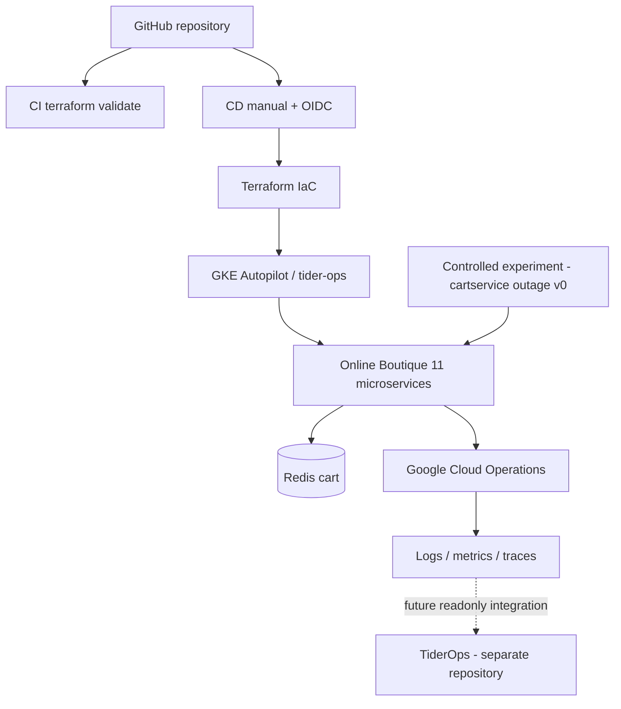

# ChaosForge architecture

NOTA: La capa TiderOps está fuera de este paquete. Cloud Operations proporciona integración; las trazas end-to-end deben verificarse tras desplegar.

## Administrador web preparado

El panel y servidor de control están en `admin/`. La ruta `deploy-admin` de GitHub Actions construye y prueba en el runner, publica por digest y aplica únicamente los recursos privados de `chaosforge-system` y el RBAC limitado en `boutique`; no ejecuta Terraform ni redespliega la tienda. SQLite en un PVC conserva el experimento y la recuperación tras reinicio. Esta extensión está implementada localmente, aún no desplegada. Ver [procedimiento y límites](../admin/DEPLOYMENT.md).
